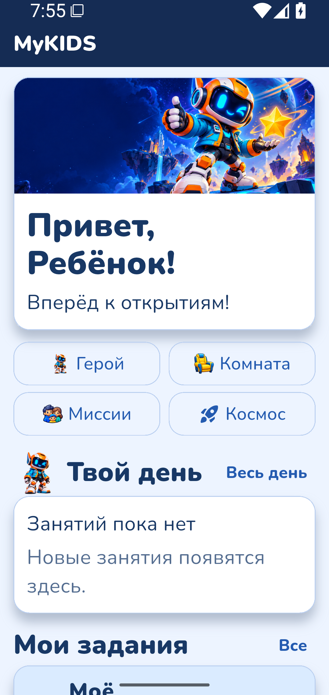
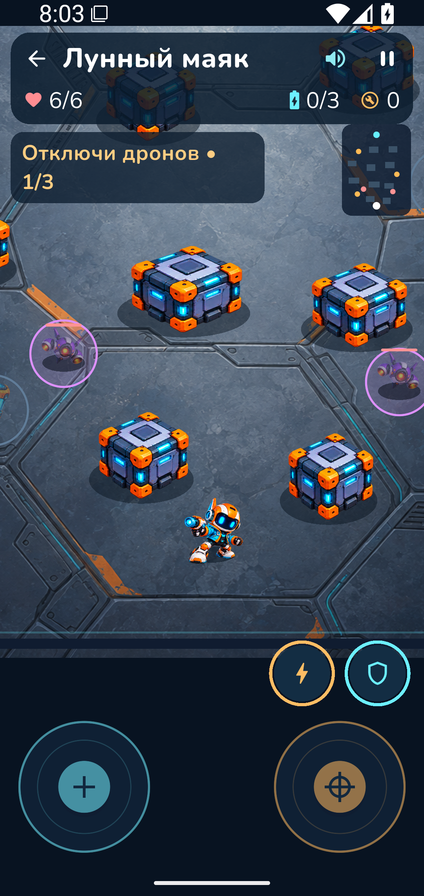

  

<h1 align="center">MyKIDS</h1>

Семейные планы, маленькие победы и космические приключения.

  <a href="README.md">English</a> · <strong>Русский</strong> ·
  <a href="https://api.xn--80ajzgig.online/downloads/MyKIDS-0.1.122.apk">Скачать для Android</a> ·
  <a href="https://github.com/ub3dqy/MyKIDS-mobile/issues/new?template=feature_request.md">Предложить идею</a>

MyKIDS собирает детский день в одном месте: школа, кружки, домашние дела и награды, на которые хочется накопить. Родители могут спланировать неделю и проверить результаты, а бабушки, дедушки и другие близкие — участвовать в семейном общении.

Для игры тоже есть место. Робот Лучик зовёт ребёнка в космические истории, предлагает загадки и отправляется с ним на настоящие игровые миссии.

## Как это выглядит

<table>
  <tr>
    <th>День с MyKIDS</th>
    <th>Космические миссии Лучика</th>
  </tr>
  <tr>
    <td></td>
    <td></td>
  </tr>
</table>

Снимки сделаны на эмуляторе Android с вымышленными данными. Сейчас интерфейс приложения на русском языке.

## Что умеет приложение

- **Планировать день.** Школьные предметы, кружки, повторяющиеся семейные задания и напоминания собраны в общем календаре.
- **Показывать результат дела.** Ребёнок отправляет комментарий или фотографии, взрослый проверяет результат. Решения семьи остаются в истории.
- **Помогать копить на желаемое.** Семья выбирает награды, ребёнок получает монеты за подтверждённые дела и ставит цель накопления. Правила поощрений и выдачу денег контролируют родители.
- **Поддерживать связь с близкими.** Есть семейные и личные чаты, голосовые сообщения, аудио- и видеозвонки.
- **Отправляться в космос с Лучиком.** Истории, загадки и девять динамичных миссий с дронами, способностями и улучшениями. Эти миссии работают без интернета и не тратят семейные монеты.
- **Выбирать своё оформление.** Доступны пять тем. Сохранённое расписание и предусмотренные действия без связи помогают пользоваться приложением, когда пропадает интернет.

Время самого дела и срок отметки можно разделить. Например, умыться нужно утром, а отметить выполнение можно позже. Результат всё равно проверяет взрослый.

## Попробовать MyKIDS

Текущая версия — **0.1.122**, для **Android 8 и новее**.

[Скачать APK](https://api.xn--80ajzgig.online/downloads/MyKIDS-0.1.122.apk)

Для входа в существующую семью нужно приглашение от родителя. Порядок сборки приложения описан в [руководстве](docs/DEVELOPMENT.md#русский).

В этом репозитории опубликовано **только приложение Android**. Серверный код, средства размещения и настройки сервера остаются закрытыми.

Опубликованные исходники соответствуют версии 0.1.122. Развитие продолжается. Проверка на настоящих телефонах ещё впереди; текущие проверки выполняются автоматически и на эмуляторах Android.

## Чего не хватает вашей семье?

**Будем рады любым советам, идеям и пожеланиям по развитию MyKIDS.** Неудобная кнопка, недостающее напоминание, другой подход к наградам или приключение, которое понравилось бы ребёнку, — всё это помогает понять, что делать дальше.

[Предложите идею](https://github.com/ub3dqy/MyKIDS-mobile/issues/new?template=feature_request.md) или [расскажите об ошибке](https://github.com/ub3dqy/MyKIDS-mobile/issues/new?template=bug_report.md). **Можно писать на русском или английском.** Достаточно нескольких предложений, разбираться в разработке необязательно.

Используйте вымышленные примеры. Не публикуйте личные данные детей, семейные фотографии, пароли и коды приглашений. О проблемах безопасности сообщайте [приватно](SECURITY.md).

---

Автор проекта — **Dima Mak / [ub3dqy](https://github.com/ub3dqy)**.
